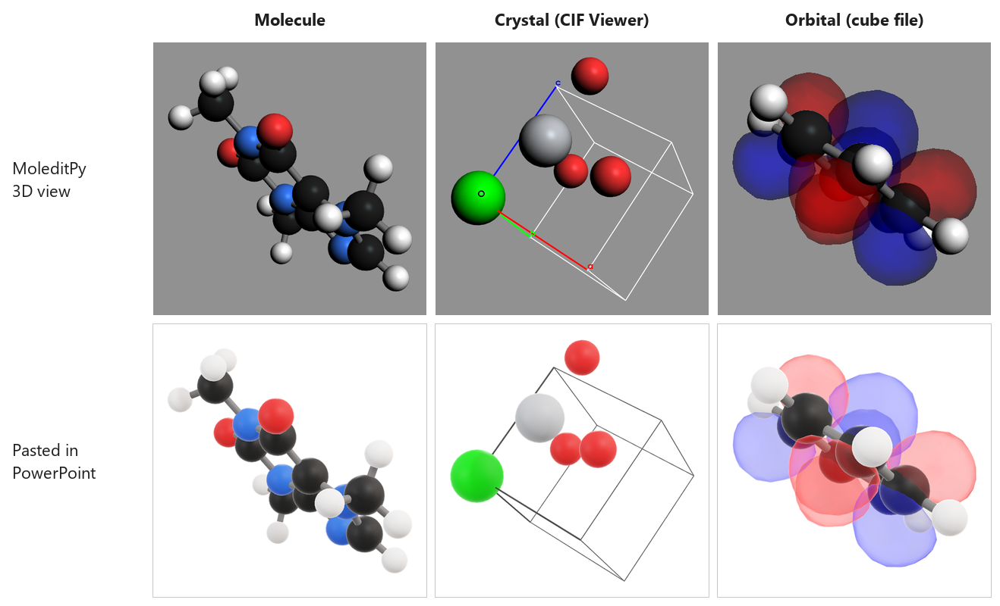
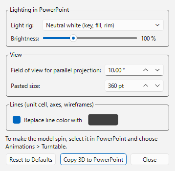
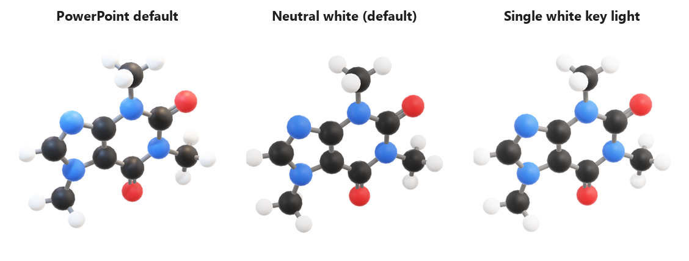

# Paste 3D to PowerPoint

A [MoleditPy](https://github.com/HiroYokoyama/python_molecular_editor) plugin that copies the
3D view to the clipboard as a **native PowerPoint 3D model**. Paste it with Ctrl+V and it can be
rotated on the slide, and with the Turntable animation it spins during the slide show. It works
offline, needs no add-in at presentation time and does not drive PowerPoint.

*Top: the MoleditPy 3D view. Bottom: the same scene pasted into PowerPoint with the default
settings. The crystal uses the line-color option, so the white unit cell shows on the slide.*

## What it exports

The plugin exports whatever the 3D view shows, so it works with other plugins without
plugin-specific code:

- molecules in any 3D style, including element colors and half-colored bonds;
- CIF Viewer crystals, with unit-cell lines and axes drawn as tubes;
- orbitals and other cube-file isosurfaces, with their transparency;
- other meshes that plugins add to the 3D view.

The model keeps the current viewing direction, colors, gloss and opacity. A parallel-projection
view becomes a narrow perspective (10° by default), because PowerPoint has only perspective
cameras.

Text labels, 2D overlays, point sprites and volume renderings have no mesh and are left out. The
status bar reports how many objects were skipped.

## Usage

| Where | Item | What it does |
|---|---|---|
| Export button / File > Export | **Copy 3D to PowerPoint** | Puts the 3D view on the clipboard. Paste into PowerPoint with Ctrl+V. |
| Export button / File > Export | **Export 3D Scene as glTF (.glb)...** | Saves the model as a `.glb` file. To use it in PowerPoint, choose Insert > 3D Models > This Device. |
| Settings | **Paste 3D to PowerPoint...** | Opens the settings window. |

1. In MoleditPy, rotate the 3D view to the direction you want.
2. Choose **Copy 3D to PowerPoint**.
3. In PowerPoint, press Ctrl+V. You can drag the model to rotate it on the slide.
4. To make it spin: select the model, choose **Animations > Turntable**, and set **Repeat** to
   *Until End of Slide*. The animation is a slide setting, so the clipboard cannot carry it.

## Settings

Changes are saved immediately in `settings.json` beside the plugin and are used for every later
copy.

| Setting | Default | Notes |
|---|---|---|
| Light rig | Neutral white (key, fill, rim) | *PowerPoint default* is PowerPoint's own warm/cool studio rig. *Single white key light* gives flat, figure-like shading. |
| Brightness | 100 % | Scales every light in the rig (10–300 %). |
| Field of view for parallel projection | 10° | Smaller is flatter. Perspective views keep their own angle. |
| Pasted size | 360 pt | Width and height of the pasted frame. |
| Replace line color | Off (#404040) | Recolors tubes made from lines, so white unit-cell lines show on a white slide. Colored axis lines are recolored too. |

The lighting, field of view and size go into the clipboard copy. A `.glb` file has no camera or
lights, so it takes only the line color.

## How the paste works

The clipboard receives three formats, and the paste target uses the richest one it supports:

| Format | Used by |
|---|---|
| `Art::GVML ClipFormat` | PowerPoint and other Office apps. A 3D model with the camera, field of view and lights from the settings. |
| `model/gltf-binary` | Apps that accept a bare glTF model. Uses the default camera. |
| bitmap | Apps without 3D support. |

Colors are converted from sRGB to the linear values glTF requires. Without this conversion,
glTF exports look washed out in PowerPoint.

## Requirements

- MoleditPy 5.x
- **Windows** for the clipboard copy. The Office clipboard formats used here are Windows names;
  macOS Office uses different pasteboard types, which this version does not support. On macOS,
  use **Export 3D Scene as glTF (.glb)...** and insert the file in PowerPoint. Slides made on
  Windows play on Mac PowerPoint unchanged.

## License

GNU Lesser General Public License. See [LICENSE](LICENSE), [COPYING](COPYING) and
[LICENSING.md](LICENSING.md).
